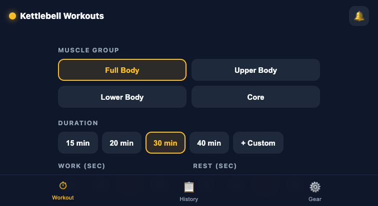

# Kettlebell Workouts

An installable PWA for auto-run, randomized kettlebell interval workouts. Pick a muscle group and a total duration — the app builds a workout you've never done before, runs it hands-free with a big countdown, rings a bell at every transition, and shows a clear illustration of each exercise so you always know what's up.




## Features

- **Muscle groups:** Full Body · Upper Body · Lower Body · Core (24 exercises, tagged and leveled)
- **Total duration:** 15 / 20 / 30 / 40 min or any custom length — the app calculates how many exercises fit
- **Work & rest intervals:** selectable on/off seconds; leftover time is added to a final "finisher" push so you finish exactly on time
- **Fully automated:** get-ready countdown → work → rest → next, all hands-free until done
- **Bell cues (Web Audio):** bright ding-ding when work starts, low bong for rest, fanfare at the end — no audio files needed; mute toggle included
- **Exercise illustrations:** every move has a hand-built vector diagram with motion arrows and a short coaching cue
- **"Next up" preview** so you can set up for the next movement during your rest
- **Always different:** exercises are dealt from a shuffled deck each session (no repeats until the whole pool cycles)
- **Difficulty filter:** All / Beginner / Intermediate / Advanced
- **Pause & resume**, stop with confirmation, screen wake-lock while running
- **Workout history** stored locally on your device (sessions, time, completion)
- **Offline-first:** service worker caches everything — works in the gym with no signal
- **Kettlebell weight** shown on-screen and selectable in settings

## Run it locally

Any static file server works:

```bash
cd kettlebell-workout
python3 -m http.server 8080
# open http://localhost:8080
```

### Install on your phone (recommended)

1. Make sure your phone is on the same Wi-Fi as the machine running the server above.
2. Open `http://<machine-ip>:8080` in Safari/Chrome.
3. Share menu → **Add to Home Screen**. It launches fullscreen, works offline, and keeps your workout history on-device.

> Note: iOS only allows installing PWAs from `https` or localhost — for a home LAN, some browsers block the "install" prompt over plain HTTP. If your phone refuses, run it through any free static host (GitHub Pages, Netlify Drop, Cloudflare Pages) and install from there. GitHub Pages is the easiest: push this repo → Settings → Pages → deploy from branch.

## Project layout

```
index.html              app shell + screens (setup / workout / history / settings)
styles.css              dark gym theme
manifest.webmanifest    PWA manifest
sw.js                   offline-first service worker
js/data.js              exercise database: names, groups, levels, cues, vector poses
js/app.js               pose renderer (SVG), Web Audio bell engine, workout state machine, UI
icons/                  generated app icons (tools/make_icons.py)
docs/                   preview screenshots
```

## How a workout is built

1. `pool = exercises tagged with the chosen group` (optionally filtered by max level).
2. Rounds `n = floor((total + rest) / (work + rest))`.
3. Exercises are dealt from a shuffled deck; when it empties, a new shuffle is dealt that doesn't repeat the last exercise.
4. Each deal gets `work` seconds, with `rest` between them; any leftover seconds extend the final work block ("finisher push").

## Adding exercises

Append an object to `EXERCISES` in `js/data.js`. Poses are simple side-view figures in a 220×180 viewBox (ground at y=164): head center, spine (neck→hip), two arms and two legs as point triples, optional bell position, motion arrows, and an optional box (for step-ups). Copy an existing entry — the renderer does the rest.

## Known limitations

- Timer accuracy depends on the page staying in the foreground; the app requests a wake lock and re-acquires it when you return to the tab, but if your phone locks mid-workout the session pauses until you reopen it (remaining time is wall-clock based, so nothing is lost).
- Illustrations are stylized diagrams, not photos — clear enough for the movement pattern; cue text covers the details.
