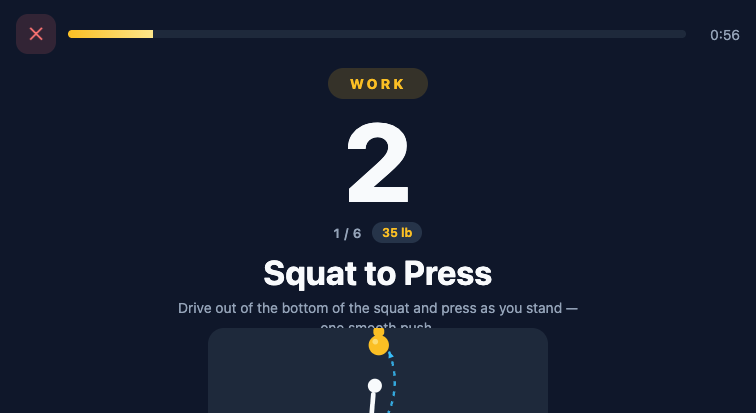
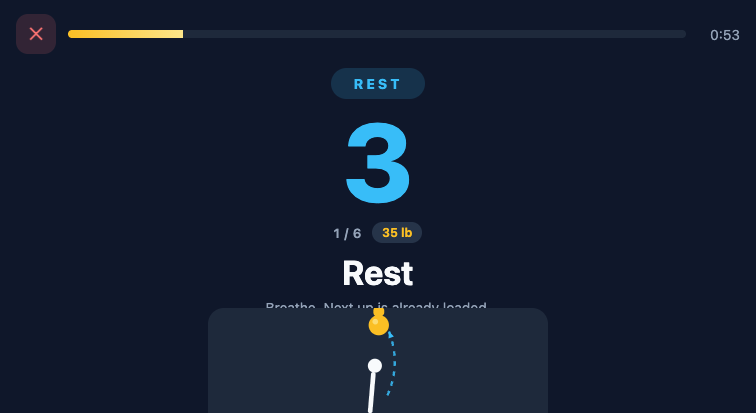
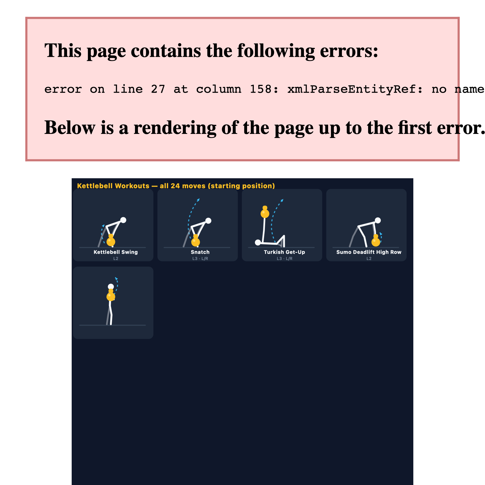

# Kettlebell Workouts

An installable PWA for auto-run, randomized kettlebell interval workouts. Pick a muscle group and a total duration — the app builds a workout you've never done before, runs it hands-free with a big countdown, rings cues at every transition (including beeps on the final 3 seconds), and shows an **animated** vector figure of each exercise so you always know what's up.





## Features

- **Muscle groups:** Full Body · Upper Body · Lower Body · Core (24 exercises, tagged and leveled). Full Body draws from *every* group so nothing gets skipped.
- **Two modes:** classic Intervals (your chosen work/rest seconds) or **EMOM** — one new move every minute for as many minutes as you pick.
- **Total duration:** 15 / 20 / 30 / 40 min or any custom length — the app calculates how many exercises fit
- **Work & rest intervals:** selectable on/off seconds; leftover time is added to a final "finisher" push so you finish exactly on time
- **Fully automated:** get-ready countdown → work → rest → next, all hands-free until done
- **Sound cues (Web Audio):** bright ding-ding when work starts, low bong for rest, **beeps at 3…2…1** before every transition (+ :30/:15 ticks in EMOM), fanfare at the end — no audio files needed; mute toggle included
- **Optional workout beat:** a synthesized 128 BPM kick/hat/bass pulse you can switch on mid-workout (off by default)
- **Animated exercise figures:** every move is a hand-built vector figure with two or more keyframes that the app morphs between while you work, plus motion arrows and a coaching cue. One-arm moves show a big **L / R** badge — and the other side always follows immediately so both arms get worked.
- **"Up next" during rest:** the whole exercise card switches to your *next* move (name, figure, L/R) on every rest period so you can set up before the bell rings; a small "Next" preview stays visible during work blocks too
- **Always different:** exercises are dealt from a shuffled deck each session (no repeats until the whole pool cycles)
- **Difficulty filter:** All / Beginner / Intermediate / Advanced
- **Pause & resume** (figure animation freezes and resumes in place), stop with confirmation, screen wake-lock while running
- **Workout history** stored locally on your device (sessions, time, completion)
- **Offline-first:** service worker caches everything — works in the gym with no signal
- **Kettlebell weight** shown on-screen and selectable in settings



## Run it locally

Any static file server works:

```bash
cd kettlebell-workout
python3 -m http.server 8080
# open http://localhost:8080
```

### Install on your phone (recommended)

1. Make sure your phone is on the same Wi-Fi as the machine running the server above.
2. Open `http://<machine-ip>:8080` in Safari/Chrome.
3. Share menu → **Add to Home Screen**. It launches fullscreen, works offline, and keeps your workout history on-device.

> Note: iOS only allows installing PWAs from `https` or localhost — for a home LAN, some browsers block the "install" prompt over plain HTTP. If your phone refuses, run it through any free static host (GitHub Pages, Netlify Drop, Cloudflare Pages) and install from there. GitHub Pages is the easiest: push this repo → Settings → Pages → deploy from branch.

## Project layout

```
index.html              app shell + screens (setup / workout / history / settings)
styles.css              dark gym theme
manifest.webmanifest    PWA manifest
sw.js                   offline-first service worker
js/data.js              exercise database: names, groups, levels, cues, vector poses
js/app.js               pose renderer (SVG), Web Audio bell engine, workout state machine, UI
icons/                  generated app icons (tools/make_icons.py)
docs/                   preview screenshots
```

## How a workout is built

1. `pool = exercises tagged with the chosen group` (optionally filtered by max level). Full Body uses the entire pool, so a session mixes every movement pattern.
2. **Interval mode:** rounds `n = floor((total + rest) / (work + rest))`; each deal gets `work` seconds with `rest` between them; leftover seconds extend the final work block ("finisher push").
3. **EMOM mode:** one 60-second work block per minute, no separate rest — recover in whatever time your move leaves you.
4. Exercises are dealt from a shuffled deck; when it empties, a new shuffle is dealt that doesn't repeat the last exercise.
5. Any `unilateral` (one-arm/leg) move is always dealt as an **L then R pair back-to-back**, so both sides get worked in every session.

## Adding exercises

Append an object to `EXERCISES` in `js/data.js`. Each entry has one or more **keyframe poses** — side-view figures in a 220×180 viewBox (ground at y=164) that the app morphs between while you perform the move: head center, spine (neck→hip), two arms and two legs as flat joint-coordinate arrays `[x1,y1,x2,y2,(x3,y3)]`, optional bell position. Static decorations — motion arrows (`arrows`) and an optional box for step-ups (`box`) — live on the exercise itself so they stay put while the figure moves. Set `unilateral: true` for single-arm/leg moves to get automatic L/R pairing. Copy an existing entry; the renderer does the rest.

## Known limitations

- Timer accuracy depends on the page staying in the foreground; the app requests a wake lock and re-acquires it when you return to the tab, but if your phone locks mid-workout the session pauses until you reopen it (remaining time is wall-clock based, so nothing is lost).
- Illustrations are stylized diagrams, not photos — clear enough for the movement pattern; cue text covers the details.
